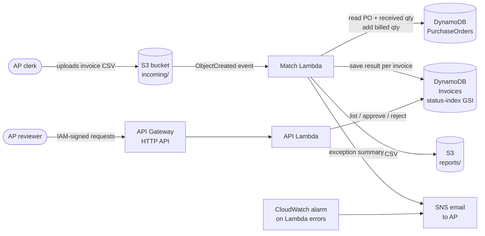

# InvoiceFlow: Serverless Invoice Three-Way Match on AWS

Checks every vendor invoice against its purchase order and goods receipt before it gets paid. Clean invoices are cleared automatically; the rest go to an AP review queue with the reason and the dollar amount at risk.

Built on AWS with S3, Lambda (Python), DynamoDB, SNS, API Gateway and CloudWatch, deployed as infrastructure-as-code with AWS SAM.

> **Data note:** the dataset is synthetic. `scripts/generate_data.py` builds 40 purchase orders, 36 goods receipts and one month of 43 vendor invoices with a fixed seed, and plants the invoice problems on purpose. Westbridge College and its vendors are made up (the same college as my [ReqTrace](https://github.com/harshita-sharmaa/reqtrace) case, one step later in the process: ReqTrace covers request-to-PO, InvoiceFlow covers invoice-to-pay).

## The question it answers

Once purchasing moves into an ERP, Accounts Payable still receives invoices as files and someone has to check each one by hand: *was this ordered, did it arrive, and is the vendor charging what we agreed?* InvoiceFlow automates that check (the "three-way match" between **PO**, **receipt** and **invoice**) so AP staff only look at the invoices that actually have a problem.

## Architecture



| Step | AWS service | What happens |
|---|---|---|
| 1. Intake | **S3** | AP drops the month's invoice file into `incoming/`. Bucket is private, encrypted and versioned. |
| 2. Match | **Lambda** (`src/match_handler.py`) | Triggered by the upload. Reads each invoice, looks up its PO, runs the match rules, saves the result. |
| 3. Records | **DynamoDB** | `PurchaseOrders` holds ordered, received and already-billed quantities. `Invoices` holds every result; a status index makes the review queue a fast query. |
| 4. Report + alert | **S3** + **SNS** | Writes `reports/<file>-results.csv` and emails AP a summary by reason and $. |
| 5. Review | **API Gateway** + **Lambda** (`src/api_handler.py`) | AP lists open exceptions, opens one, and approves or rejects it with a note. Records who decided. |
| 6. Monitoring | **CloudWatch** | Alarm emails the same topic if the match function errors. |

## Match rules

| Rule | Exception when | $ at risk |
|---|---|---|
| `DUPLICATE` | Same vendor + invoice number already received | Full invoice |
| `NO_PO` | PO number missing or not found | Full invoice |
| `VENDOR_MISMATCH` | Invoice vendor is not the PO's vendor | Full invoice |
| `NOT_RECEIVED` | Nothing received on the PO yet | Full invoice |
| `QTY_OVER_RECEIVED` | Billed qty > received qty not already billed | Amount above what was received |
| `PRICE_VARIANCE` | Unit price more than **2%** above the PO price | Amount above PO price |
| `TOTAL_MISMATCH` | Invoice total ≠ qty × unit price | Amount above what PO + receipt support |

Everything else is **MATCHED** and cleared for payment. The 2% tolerance is one constant in `src/matching.py`, so small rounding or freight differences do not create work for AP.

## Results

From the October sample file (`outputs/alert_email.txt` is the email AP receives):

| | Invoices | $ billed |
|---|---|---|
| **Matched, cleared for payment automatically** | **27 (63%)** | $103,431.60 |
| On hold for AP review | 16 (37%) | $71,516.30 |
| **Total** | 43 | $174,947.90 |

| Exception | Invoices | $ not supported by PO/receipt |
|---|---|---|
| Billed before anything was received | 3 | $11,415.26 |
| Invoice total doesn't add up | 1 | $11,413.08 |
| Billed more than was received | 3 | $7,910.62 |
| Duplicate invoice | 2 | $5,761.58 |
| No valid PO | 2 | $2,405.00 |
| Price above PO (over 2%) | 4 | $1,843.08 |
| Vendor doesn't match PO | 1 | $1,606.64 |
| **Total** | **16** | **$42,355.26** |

What the run shows:

- **AP reviews 16 invoices instead of 43.** The other 27 matched and need no one.
- **$42K would have been paid without support** if invoices were paid as billed. The biggest single item is a typo: a print vendor billed 2 brochure runs at $634.06 but totalled the invoice at **$12,681.20** instead of $1,268.12 (the same decimal-slip pattern ReqTrace found in manual PO entry).
- **Tolerance keeps noise out.** Two invoices priced 1–1.5% above the PO still matched; four priced 6–12% above were held.
- **Duplicates are caught across files, not just within one.** A resent invoice is held even if it arrives next month, and the original record is never overwritten.

## Design choices worth explaining

- **Idempotent on retries.** S3 can deliver the same event twice and Lambda retries on failure. Every result stores the file and line it came from, and a line already processed is skipped, so a retry never double-bills a receipt or flags a whole file as duplicates. (`run_local.py` replays the event to prove it: 43 lines skipped.)
- **Billed quantity is tracked on the PO.** A second invoice can't bill the same received goods again; it fails `QTY_OVER_RECEIVED`.
- **Rules are separate from AWS.** `src/matching.py` is plain Python with no AWS calls, so the same rules run in Lambda, locally and in tests.
- **Least privilege + audit trail.** Each function gets only the table/bucket access it needs (the match function can write only to `reports/`). The review API uses IAM auth, an exception can be resolved only once (DynamoDB conditional update), and the reviewer's IAM identity and note are saved on the record.
- **Money is `Decimal`, not float**, so totals don't drift by fractions of a cent.

## Repository

```
template.yaml               SAM template: S3, 2 Lambdas, 2 DynamoDB tables, SNS, HTTP API, CloudWatch alarm
src/matching.py             match rules, batch processing, summary (no AWS code)
src/store.py                DynamoDB store + in-memory store with the same methods
src/match_handler.py        Lambda for S3 uploads
src/api_handler.py          Lambda for the review API
scripts/generate_data.py    builds the synthetic data in data/
scripts/run_local.py        runs the whole flow locally, writes outputs/
scripts/seed_dynamodb.py    loads POs + receipts into the deployed table
tests/test_matching.py      18 unit tests: rules, duplicates, retries, review API
events/s3_put.json          sample S3 event for `sam local invoke`
```

## Run it locally (no AWS account needed)

Python 3.9+ and the standard library only.

```bash
python3 scripts/generate_data.py             # rebuild data/ (same seed, same numbers)
python3 scripts/run_local.py                 # match the October file, write outputs/
python3 -m unittest discover -s tests -v     # 18 tests
```

## Deploy to AWS

Needs the [AWS SAM CLI](https://docs.aws.amazon.com/serverless-application-model/latest/developerguide/install-sam-cli.html) and AWS credentials.

```bash
sam build
sam deploy --guided --parameter-overrides AlertEmail=you@example.com
# confirm the SNS subscription email, then:
pip install -r requirements.txt
python3 scripts/seed_dynamodb.py <PurchaseOrdersTableName from the outputs>
aws s3 cp data/invoices_2026-10.csv s3://<BucketName>/incoming/
```

Within a few seconds the summary email arrives and `reports/invoices_2026-10-results.csv` appears in the bucket. Query the review queue (IAM-signed, e.g. with [awscurl](https://github.com/okigan/awscurl)):

```bash
awscurl --service execute-api "<ApiUrl>/invoices?status=EXCEPTION"
awscurl --service execute-api -X POST -d '{"decision":"APPROVED","note":"Price increase agreed by buyer"}' \
  "<ApiUrl>/invoices/V160%23GGAV-4411/resolve"
```

**Cost:** everything is serverless and on-demand, so an idle stack costs close to nothing, and a few files a month stays within or near the AWS free tier. Remove it with `sam delete` (empty the bucket first).

## What I'd add next

- Read PDF invoices with **Amazon Textract** instead of CSV.
- Pull POs and receipts from the ERP on a schedule (EventBridge) instead of a seed script.
- Line-level matching for multi-line POs, and a small web front end for the review queue.
